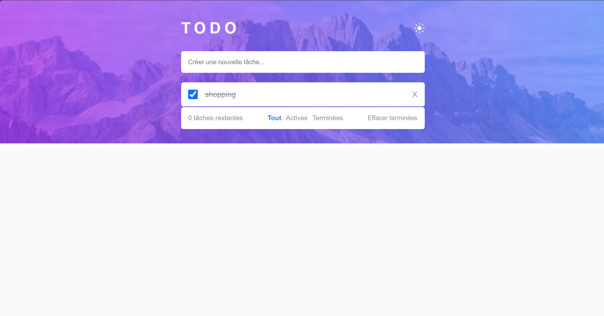

# Frontend Mentor - Todo app solution

Ceci est ma solution au [Todo app challenge sur Frontend Mentor](https://www.frontendmentor.io/challenges/todo-app-Su1_KokOW).

## Table des matières

- [Overview](#overview)
  - [Le challenge](#le-challenge)
  - [Capture d'écran](#capture-décran)
  - [Liens](#liens)
- [Mon process](#mon-process)
  - [Outils utilisés](#outils-utilisés)
  - [Ce que j'ai appris](#ce-que-jai-appris)
  - [Pistes d'amélioration](#pistes-damélioration)
- [Auteur](#auteur)

## Overview

### Le challenge

L'utilisateur doit pouvoir :

- Voir un affichage adapté selon la taille de l'écran (mobile / desktop)
- Voir un effet au survol des éléments interactifs
- Ajouter de nouvelles tâches à la liste
- Cocher une tâche comme terminée
- Supprimer une tâche de la liste
- Filtrer les tâches (toutes / actives / terminées)
- Effacer toutes les tâches terminées d'un coup
- Basculer entre le mode clair et le mode sombre

**Bonus (pas encore fait) :** glisser-déposer pour réorganiser les tâches.

### Capture d'écran



### Liens

- Solution URL : [Mon dépôt GitHub](https://github.com/Nourhene-coder/todo_app)


## Mon process

### Outils utilisés

- HTML5 sémantique
- CSS (variables CSS pour gérer le thème clair/sombre)
- Flexbox
- Mobile-first
- JavaScript "vanilla" (sans framework)

### Ce que j'ai appris

Sur ce projet j'ai surtout travaillé la manipulation du DOM en JavaScript pur : créer des éléments dynamiquement, les ajouter/supprimer de la liste, et mettre à jour l'affichage à chaque changement.

Exemple de code dont je suis content, la fonction qui réaffiche la liste selon le filtre choisi :

```js
function afficherTodos() {
  todoList.innerHTML = "";

  let todosAffichees = todos;
  if (filter === "active") {
    todosAffichees = todos.filter(t => !t.completed);
  } else if (filter === "completed") {
    todosAffichees = todos.filter(t => t.completed);
  }
  // ...
}
```

J'ai aussi appris à gérer le mode sombre avec des variables CSS et une simple classe `.dark` ajoutée sur le `<body>`.

### Pistes d'amélioration

- Ajouter le glisser-déposer pour réorganiser les tâches (le bonus du challenge)
- Sauvegarder les tâches dans le `localStorage` pour qu'elles restent après un rechargement de la page
- Ajouter des messages d'erreur si l'utilisateur essaie d'ajouter une tâche vide

## Auteur

- Nom - Nourhene
- Frontend Mentor - [@Nourhene-coder](https://www.frontendmentor.io/profile/Nourhene-coder)